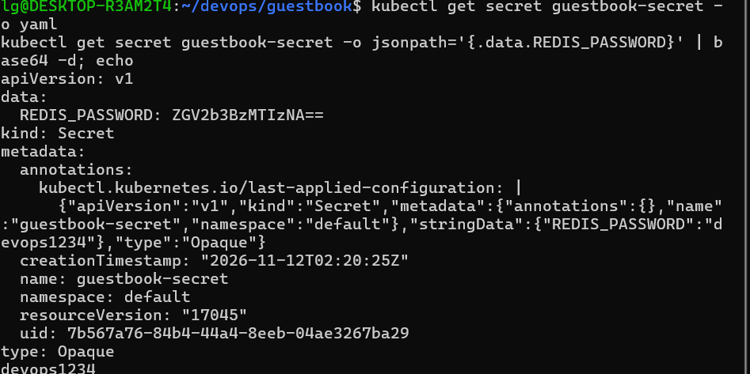
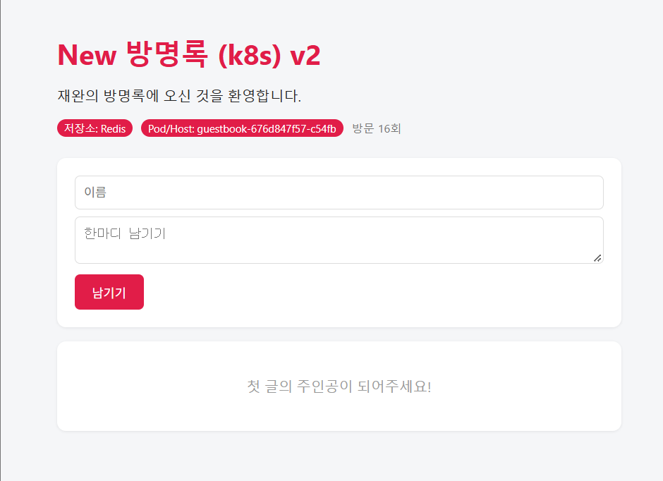
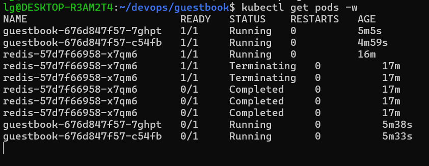
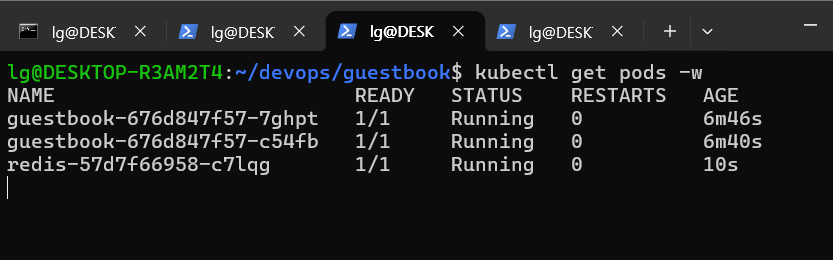
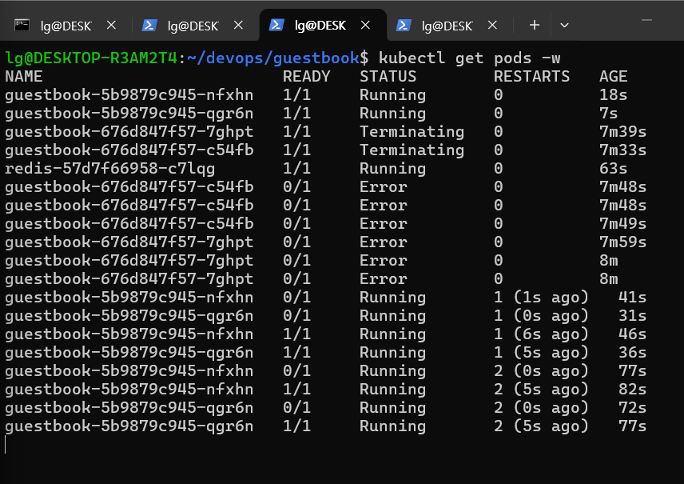
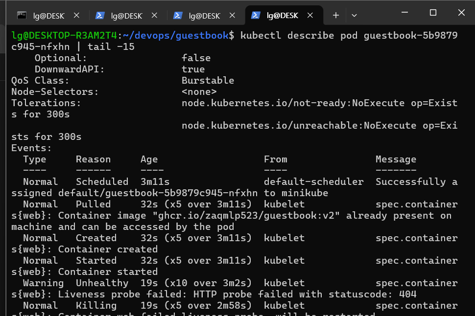

# Week 11 - ConfigMap, Secret, Probe

## 1. Secret은 왜 안전하지 않은가

`kubectl get secret -o yaml`로 본 `ZGV2b3BzMTIzNA==`는 암호화된 값이 아니라 글자를 base64로 바꿔 적은 것이다. `base64 -d`를 한 번 하면 `devops1234`가 그대로 출력된다. 또 `kubectl apply`로 만든 Secret은 `last-applied-configuration` 어노테이션에도 비밀번호가 평문으로 남는다. 따라서 Secret 조회 권한이 있는 사람은 누구나 값을 읽을 수 있고, Secret YAML을 Git에 올리면 비밀번호가 그대로 공개된다.

그래서 `secret.yaml`은 `.gitignore`에 넣고, 비밀번호를 `CHANGE_ME`로 바꾼 `secret.yaml.example`만 Git에 올렸다.

## 2. ConfigMap만 변경하기

ConfigMap의 `APP_TITLE`을 `방명록 (k8s)`에서 `New 방명록 (k8s)`로, `THEME_COLOR`를 `#16a34a`(초록)에서 `#e11d48`(빨강)으로 바꾸고 `kubectl rollout restart deployment guestbook`만 실행했다.

- 이미지를 다시 빌드하지 않았다.
- 코드를 고치지 않았다.
- Redis에 저장된 방명록 데이터는 그대로였다.

같은 이미지에 다른 ConfigMap을 주입하는 방식이다. 환경 변수는 프로세스가 시작할 때 정해지므로, 이미 떠 있는 Pod는 옛 값을 쓰기 때문에 restart가 필요했다.

## 3. readiness 실패

Redis를 `kubectl scale deployment redis --replicas=0`으로 내리자 guestbook Pod가 `STATUS Running`인데 `READY 0/1`이 되었다. 앱 프로세스는 살아 있지만 `/readyz`가 Redis에 연결하지 못해 503을 반환하므로, 쿠버네티스가 이 Pod를 Service 대상에서 빼고 트래픽을 보내지 않는다. `RESTARTS`는 0이어서 재시작은 일어나지 않았다.

Redis를 `--replicas=1`로 다시 올리자 guestbook이 자동으로 `1/1`로 복구되었다.

## 4. liveness 실패

liveness probe 경로를 일부러 없는 `/devops`로 바꾸자 404가 나왔고, kubelet이 컨테이너를 계속 재시작해서 `RESTARTS`가 1, 2로 올라갔다.

`kubectl describe pod`의 Events에 `Liveness probe failed: HTTP probe failed with statuscode: 404`와 `failed liveness probe, will be restarted`가 기록되었다. 앱이 멀쩡해도 probe 경로가 틀리면 계속 재시작되므로 probe 설정은 신중하게 해야 한다.

readiness는 "요청을 받아도 되는가"를 보고 실패하면 트래픽만 끊고, liveness는 "다시 시작해야 하는가"를 보고 실패하면 컨테이너를 재시작한다는 차이가 있다.

## 5. 트러블슈팅 3단 루틴

1. **상태 확인** - `kubectl get pods`
   STATUS, READY, RESTARTS를 보고 어떤 증상인지 파악한다.
